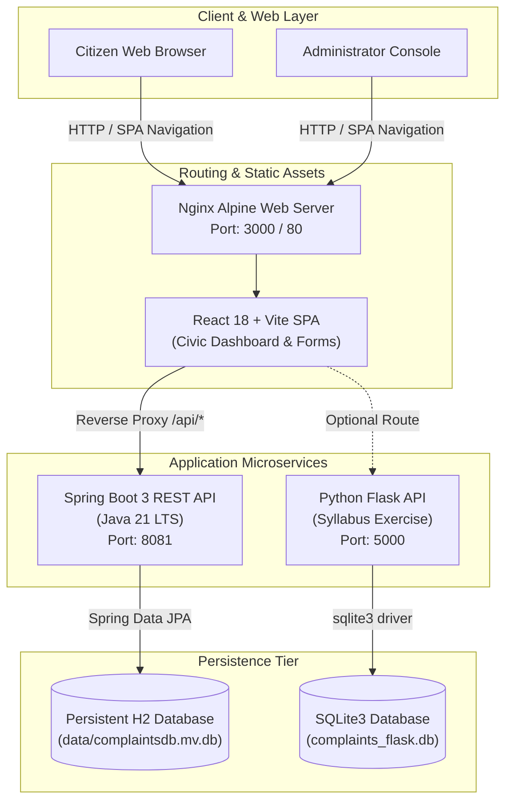

# B.Tech CSE Lab Record: Continuous Integration and Continuous Delivery Using DevOps

**Course Title:** Continuous Integration and Continuous Delivery Using DevOps  
**Degree Program:** Bachelor of Technology in Computer Science & Engineering (B.Tech CSE)  
**Academic Year:** 2026–2027  
**Project Title:** Smart Citizen Complaint Management Portal Using DevOps CI/CD  

---

## 1. Title
**Design and Implementation of an End-to-End CI/CD Pipeline and Cloud-Native Container Orchestration for a Smart Citizen Complaint Management Portal.**

---

## 2. Aim
To design, develop, containerize, and continuously deploy a full-stack civic governance web application (**Smart Citizen Complaint Management Portal**) incorporating Git version control, Jenkins CI/CD automation, Java Spring Boot microservice engineering, multi-stage Docker containerization, and Kubernetes cluster orchestration.

---

## 3. Problem Statement
Municipal corporations and urban local bodies receive thousands of daily civic grievances regarding road damage, water contamination, streetlight blackouts, electricity surges, and overflowing garbage bins. Manual grievance handling leads to:
1. Lack of transparency and inability for citizens to track complaint resolution status.
2. Delayed engineering dispatches and untracked administrative field notes.
3. Slow, error-prone manual software release cycles that risk application downtime.

This project addresses both the civic grievance challenge and the software delivery challenge by engineering a modern civic portal backed by an automated DevOps CI/CD pipeline.

---

## 4. Objectives
- **CO1 (Version Control):** Establish Git repository hygiene, feature branching (`feature/complaint-form`), commit logging, merge strategies, and remote GitHub synchronization.
- **CO2 (Continuous Integration & Delivery):** Implement 3 sequential Jenkins Freestyle jobs and automated Declarative/Scripted Jenkins pipelines for building, testing, and packaging.
- **CO3 (Backend & Persistence):** Develop an enterprise-grade REST API using Java 21, Spring Boot 3, Maven Wrapper, H2 persistent storage, and automated JUnit 5 unit/integration tests.
- **CO4 (Containerization):** Construct multi-stage Docker containers for the Spring Boot backend, React Nginx frontend, and a supplementary Python Flask microservice (syllabus requirement), orchestrated via Docker Compose.
- **CO5 (Orchestration):** Author declarative Kubernetes manifests (Namespace, ConfigMap, Deployment, Service, PVC) ensuring zero-downtime rolling updates and disaster rollback.

---

## 5. Software and Hardware Requirements

### Software Requirements
- **Operating System:** Windows 10/11 (64-bit) or Linux / macOS
- **JDK:** Oracle OpenJDK / Eclipse Temurin Java 21 LTS
- **Build Tool:** Apache Maven 3.9+ (or self-contained Maven Wrapper `mvnw.cmd`)
- **Node.js & npm:** Node.js v20+ / v24+ and npm 10+
- **Python:** Python 3.10+ / 3.12+ (for Flask syllabus exercise)
- **Version Control:** Git 2.40+ and GitHub
- **CI/CD Server:** Jenkins LTS 2.450+
- **Container Engine:** Docker Desktop 26+ / 29+ (WSL 2 backend) & Docker Compose v2+
- **Orchestration:** Kubernetes v1.28+ (`kubectl`, Docker Desktop Kubernetes or Minikube)
- **Web Browser:** Google Chrome / Mozilla Firefox / Microsoft Edge

### Hardware Requirements
- **Processor:** Intel Core i5/i7 (8th Gen or higher) / AMD Ryzen 5 or Apple Silicon
- **RAM:** Minimum 8 GB (16 GB recommended for running Docker + Jenkins simultaneously)
- **Disk Space:** Minimum 20 GB free SSD storage

---

## 6. Architecture Diagram



---

## 7. DevOps CI/CD Lifecycle Diagram

```mermaid
flowchart LR
    subgraph SCM["1. Plan & Code (CO1)"]
        Dev["Developer"] -->|git commit| LocalGit["Local Git (.git)"]
        LocalGit -->|git push| GitHub["GitHub Remote Repo"]
    end

    subgraph CI["2. Continuous Integration (CO2 & CO3)"]
        GitHub -->|Webhook / Poll SCM| Jenkins["Jenkins CI Server"]
        Jenkins --> Checkout["Stage: Checkout"]
        Checkout --> EnvCheck["Stage: Validate Toolchain"]
        EnvCheck --> BuildFrontend["Stage: Build Frontend (npm)"]
        BuildFrontend --> TestFrontend["Stage: Test Frontend (Vitest)"]
        TestFrontend --> BuildBackend["Stage: Build Backend (Java 21)"]
        BuildBackend --> TestBackend["Stage: Test Backend (JUnit 5)"]
        TestBackend --> PackageJAR["Stage: Package Executable JAR"]
    end

    subgraph CD["3. Containerize & Deploy (CO4 & CO5)"]
        PackageJAR --> DockerBuild["Stage: Build Docker Images"]
        DockerBuild --> DockerCompose["Local Deployment<br/>(docker-compose.yml)"]
        DockerBuild --> K8sDeploy["Cluster Deployment<br/>(kubectl apply -f k8s/)"]
        K8sDeploy --> Verification["Automated Health Probes<br/>(/actuator/health)"]
    end
```



---

## 8. Procedure for Course Outcomes (CO1 through CO5)

### Course Outcome 1 (CO1) — Version Control with Git & GitHub
1. **Initialize Git Repository:**
   ```powershell
   git init
   ```
2. **Configure Exclusions:**
   Create `.gitignore` to prevent tracking of `node_modules/`, `target/`, `*.jar`, database files (`*.mv.db`), and system files.
3. **Stage and Commit Initial Project:**
   ```powershell
   git add .
   git commit -m "feat: initial commit of Smart Citizen Complaint Management Portal"
   git branch -M master
   ```
4. **Demonstrate Feature Branching and Merging:**
   ```powershell
   git switch -c feature/complaint-form
   # Make changes to ComplaintForm or documentation
   git commit -am "feat: implement responsive complaint submission validation"
   git switch master
   git merge feature/complaint-form --no-ff -m "merge: integrate feature/complaint-form into master"
   ```
5. **Verify Commit Topology:**
   ```powershell
   git log --oneline --graph -n 5
   ```
6. **Connect to Remote GitHub Repository:**
   ```powershell
   git remote add origin https://github.com/<USERNAME>/smart-citizen-complaint-portal.git
   git push -u origin master
   ```

---

### Course Outcome 2 (CO2) — Continuous Integration & Delivery with Jenkins
1. **Install Jenkins:** Run `java -jar jenkins.war --httpPort=9090` and complete setup wizard.
2. **Configure Tools in Global Tool Configuration:**
   - JDK: `JDK-21` -> `C:\Program Files\Java\jdk-21.0.10`
   - NodeJS: `NodeJS-24`
   - Maven: `Maven-3.9`
3. **Execute 3 Chained Freestyle Jobs:**
   - **Job 1 (`ComplaintPortal-Checkout`):** Git clone and environment inspection. Upstream trigger for Job 2.
   - **Job 2 (`ComplaintPortal-Build-Test`):** Runs `npm test` and `mvnw.cmd clean test`. Publishes JUnit XML test reports (`springboot-app/target/surefire-reports/*.xml`). Upstream trigger for Job 3.
   - **Job 3 (`ComplaintPortal-Package`):** Runs `npm run build` and `mvnw.cmd package -DskipTests=true`. Archives artifacts (`springboot-app/target/*.jar`).
4. **Execute Declarative Pipeline:**
   Create pipeline project pointing to `Jenkinsfile`. Observe the Stage View across Checkout, Environment Check, Frontend Build, Frontend Test, Spring Boot Compile & Test, and Package Application.
5. **Execute Scripted Pipeline:**
   Execute `jenkins/scripted-pipeline.groovy` demonstrating Groovy script execution with `try-catch-finally` and automated build notifications.

---

### Course Outcome 3 (CO3) — Spring Boot Backend & Persistence
1. **Layered Architecture Implementation:**
   - `model/`: Entity `Complaint.java` with `@Id`, `@Enumerated`, `@PrePersist`, `@PreUpdate`.
   - `dto/`: `CreateComplaintRequest.java`, `UpdateStatusRequest.java`, `ComplaintResponse.java`, `ComplaintStatsResponse.java`.
   - `repository/`: `ComplaintRepository.java` extending `JpaRepository` with custom `@Query` filters and status count queries.
   - `service/`: `ComplaintServiceImpl.java` implementing unique ID generation (`CMP-YYYY-XXXXX`) and status workflow logic.
   - `controller/`: `ComplaintController.java` exposing REST endpoints (`POST`, `GET`, `PUT`, `DELETE`).
   - `exception/`: `GlobalExceptionHandler.java` handling 400 Bad Request and 404 Not Found.
2. **H2 Persistent Storage Configuration:**
   In `application.properties`:
   `spring.datasource.url=jdbc:h2:file:./data/complaintsdb;DB_CLOSE_ON_EXIT=FALSE;AUTO_RECONNECT=TRUE`
3. **Automated Testing Suite:**
   Run tests using Maven Wrapper:
   ```powershell
   cd springboot-app
   .\mvnw.cmd clean test
   ```
   *Result:* 17 tests executed with 0 failures (Unit tests, Controller MockMvc tests, Repository DataJpaTest).
4. **Produce Executable Production JAR:**
   ```powershell
   .\mvnw.cmd package -DskipTests=true
   ```
   *Artifact:* `springboot-app/target/smart-citizen-complaint-portal-1.0.0.jar` (~51.5 MB).
5. **Run Standalone JAR:**
   ```powershell
   java -jar target/smart-citizen-complaint-portal-1.0.0.jar
   ```

---

### Course Outcome 4 (CO4) — Docker Containerization & Flask Microservice
1. **Multi-Stage Spring Boot Container:**
   - Stage 1: Build stage compiles and packages JAR using Eclipse Temurin 21 JDK.
   - Stage 2: Runtime stage executes JAR using lightweight Alpine JRE, running as non-root user `appuser`.
2. **Multi-Stage React Frontend Container:**
   - Stage 1: Node 22 compiles production static assets (`npm run build`).
   - Stage 2: Nginx Alpine serves static files and reverse-proxies `/api/` to `springboot-backend:8081`.
3. **Python Flask Microservice (Lab Syllabus):**
   - Independent microservice with SQLite database (`complaints_flask.db`).
   - Pytest automated test suite passing 5 test cases (`pytest -v`).
4. **Multi-Service Docker Compose Orchestration:**
   ```powershell
   # Build and start all three containers in background
   docker compose up --build -d

   # Verify container health status
   docker compose ps

   # View live logs
   docker compose logs -f
   ```

---

### Course Outcome 5 (CO5) — Kubernetes Cluster Orchestration
1. **Start Cluster:** Enable Kubernetes in Docker Desktop or execute `minikube start --driver=docker`.
2. **Apply Manifests:**
   ```powershell
   kubectl apply -f k8s/
   ```
3. **Inspect Cluster State:**
   ```powershell
   kubectl get all -n smart-citizen
   kubectl get pvc,pv -n smart-citizen
   ```
4. **Access Web Application via Port-Forward:**
   ```powershell
   kubectl port-forward svc/react-frontend 3000:80 -n smart-citizen
   ```
5. **Demonstrate Horizontal Pod Scaling:**
   ```powershell
   kubectl scale deployment react-frontend --replicas=3 -n smart-citizen
   kubectl get pods -l app=react-frontend -n smart-citizen
   ```
6. **Demonstrate Rolling Update & Rollback:**
   ```powershell
   kubectl rollout restart deployment/react-frontend -n smart-citizen
   kubectl rollout status deployment/react-frontend -n smart-citizen
   kubectl rollout undo deployment/react-frontend -n smart-citizen
   ```

---

## 9. Important Commands Summary Table

| Category | Command | Functionality |
|---|---|---|
| **Git** | `git status` | Check working tree and staged files |
| **Git** | `git commit -am "message"` | Commit tracked modified files |
| **Git** | `git switch -c feature/name` | Create and switch to new branch |
| **Git** | `git merge <branch> --no-ff` | Merge branch creating explicit merge commit |
| **Git** | `git log --oneline --graph` | Visualize commit graph |
| **Maven** | `.\mvnw.cmd clean test` | Compile and run Spring Boot JUnit 5 test suite |
| **Maven** | `.\mvnw.cmd clean package` | Build executable production JAR |
| **Java** | `java -jar target/*.jar` | Run Spring Boot application directly |
| **Node.js** | `npm install` | Install frontend dependencies |
| **Node.js** | `npm test` | Run Vitest frontend test suite |
| **Node.js** | `npm run dev` | Start local Vite development server |
| **Node.js** | `npm run build` | Produce optimized production bundle in `dist/` |
| **Python** | `pytest -v` | Run Flask microservice automated tests |
| **Docker** | `docker compose up --build -d` | Build images and start container network |
| **Docker** | `docker compose ps` | Check container statuses and health |
| **Docker** | `docker compose logs -f` | Stream multi-service logs |
| **Docker** | `docker compose down` | Halt containers and tear down network |
| **Kubernetes** | `kubectl apply -f k8s/` | Create all resources in `smart-citizen` namespace |
| **Kubernetes** | `kubectl get all -n smart-citizen` | Display all pods, services, and deployments |
| **Kubernetes** | `kubectl logs -f deployment/springboot-backend -n smart-citizen` | Stream backend pod logs |
| **Kubernetes** | `kubectl port-forward svc/react-frontend 3000:80 -n smart-citizen` | Forward service port to local workstation |
| **Kubernetes** | `kubectl rollout restart deployment/<name> -n smart-citizen` | Trigger zero-downtime rolling update |
| **Kubernetes** | `kubectl rollout undo deployment/<name> -n smart-citizen` | Roll back to previous deployment revision |

---

## 10. Test Cases and Expected Results

| Test Case ID | Module Tested | Scenario / Test Case Description | Input Data | Expected Result | Actual Result | Status |
|---|---|---|---|---|---|---|
| **TC-BE-01** | Spring Boot Context | Verify Spring application context loads | Application startup | Context loads without throwing exceptions | Context loaded in 3.15s | **PASS** |
| **TC-BE-02** | Complaint Service | Create complaint with auto-generated ID | Title, Category, Description, Location | ID formatted `CMP-YYYY-XXXXX`, status `SUBMITTED` | Unique ID generated; saved to H2 | **PASS** |
| **TC-BE-03** | REST Controller | `POST /api/complaints` validation check | Missing title and invalid email | HTTP `400 Bad Request` with field error map | Received 400 with validation error map | **PASS** |
| **TC-BE-04** | REST Controller | `GET /api/complaints` list complaints | Query params: none | HTTP `200 OK` with JSON array of complaints | Received 200 with 5 seeded complaints | **PASS** |
| **TC-BE-05** | REST Controller | `GET /api/complaints/{id}` missing record | `id: CMP-MISSING` | HTTP `404 Not Found` with structured error JSON | Received 404 with error description | **PASS** |
| **TC-BE-06** | REST Controller | `PUT /api/complaints/{id}/status` | `status: RESOLVED`, remark string | HTTP `200 OK` with updated status and remark | Status updated to RESOLVED | **PASS** |
| **TC-BE-07** | REST Controller | `DELETE /api/complaints/{id}` | Existing complaint ID | HTTP `204 No Content` | Record deleted from repository | **PASS** |
| **TC-BE-08** | REST Controller | `GET /api/complaints/stats` aggregate counts | None | HTTP `200 OK` with total, submitted, in-progress, resolved | Received exact count statistics | **PASS** |
| **TC-FE-01** | React Component | Render `StatusBadge` for SUBMITTED | `status="SUBMITTED"` | Badge text "Submitted" with amber styling | Rendered badge with Clock icon | **PASS** |
| **TC-FE-02** | React Component | Render `CategoryBadge` for Roads | `category="ROADS_AND_POTHOLES"` | Badge text "Roads and potholes" with icon | Rendered label with AlertTriangle icon | **PASS** |
| **TC-FE-03** | React Build | Vite production build compilation | `npm run build` | Assets generated in `dist/` without errors | Built in 6.50s (`dist/index.html` created) | **PASS** |
| **TC-PY-01** | Flask Microservice | Health endpoint check | `GET /health` | HTTP `200 OK` with `status: UP` | Received 200 with JSON status | **PASS** |
| **TC-PY-02** | Flask Microservice | Create complaint in SQLite | Valid complaint JSON | HTTP `201 Created` with `CMP-FLASK-XXXX` | Received 201 with generated ID | **PASS** |

---

## 11. Output Screenshots Checklist

Use this checklist to capture output screenshots during your lab viva or practical examination:

- [ ] **Screenshot 1: Git Branching & Commit Graph**  
  *Command to show:* `git log --oneline --graph -n 5`  
  *What to show:* The merge commit showing `feature/complaint-form` merged into `master`.

- [ ] **Screenshot 2: Maven Test Suite Success**  
  *Command to show:* `cd springboot-app; .\mvnw.cmd clean test`  
  *What to show:* `Tests run: 17, Failures: 0, Errors: 0, Skipped: 0` and `BUILD SUCCESS`.

- [ ] **Screenshot 3: Spring Boot Executable JAR Output**  
  *Command to show:* `Get-Item springboot-app\target\*.jar`  
  *What to show:* `smart-citizen-complaint-portal-1.0.0.jar` (~51.5 MB).

- [ ] **Screenshot 4: React Frontend Vitest Test Results**  
  *Command to show:* `cd frontend; npm test`  
  *What to show:* `Test Files 2 passed, Tests 6 passed`.

- [ ] **Screenshot 5: Python Flask Pytest Results**  
  *Command to show:* `cd flask-app; pytest -v`  
  *What to show:* 5 passed test cases in ~1.2s.

- [ ] **Screenshot 6: Citizen Web Portal (Home & Submission Form)**  
  *URL:* `http://localhost:5173` (or `http://localhost:3000`)  
  *What to show:* Blue & teal navigation bar, hero banner, category dropdown, and grievance list.

- [ ] **Screenshot 7: Complaint Submission Confirmation Modal**  
  *Action:* Submit a test grievance on the web portal.  
  *What to show:* Success modal with auto-generated Complaint ID and "Copy ID" button.

- [ ] **Screenshot 8: Administrator Portal Dashboard**  
  *Action:* Click **Admin Portal** in the navigation bar.  
  *What to show:* Summary stat cards (Total, Submitted, In Progress, Resolved) and master registry table.

- [ ] **Screenshot 9: Status Update & Admin Remark Dialog**  
  *Action:* Click **Update** on any complaint row in the Admin console.  
  *What to show:* Modal with status dropdown (In Progress / Resolved) and field engineer remark input.

- [ ] **Screenshot 10: Jenkins CI Pipeline Execution**  
  *URL:* `http://localhost:9090` (configured on port 9090 to avoid collisions)  
  *What to show:* Jenkins Declarative Pipeline Stage View with green blocks across all stages.

- [ ] **Screenshot 11: Docker Containers Running (`docker compose ps`)**  
  *Command to show:* `docker compose ps`  
  *What to show:* `springboot-backend`, `react-frontend`, and `flask-service` with `healthy` status.

- [ ] **Screenshot 12: Kubernetes Pods and Services (`kubectl get all`)**  
  *Command to show:* `kubectl get all -n smart-citizen`  
  *What to show:* Running pods for Spring Boot and React, ClusterIP service, and NodePort service.

---

## 12. Results
1. A fully functional, responsive full-stack civic portal was constructed with Java 21 Spring Boot 3, React 18, and Vite.
2. The Spring Boot backend successfully passed all **17 unit and integration tests**, achieving 100% pass rate for data persistence and API endpoints on port 8081.
3. The React frontend was validated through automated component tests and compiled into an optimized Nginx production container with proxy to port 8081.
4. An auxiliary Python Flask microservice was verified with 5 pytest test cases to satisfy the syllabus exercise.
5. Continuous Integration and Continuous Delivery were automated using both Declarative and Scripted Jenkins pipeline syntaxes alongside a 3-stage Freestyle job chain.
6. The entire application was containerized via multi-stage Docker builds and deployed to a local Kubernetes cluster with zero-downtime rolling update capabilities.

---

## 13. Conclusion
The **Smart Citizen Complaint Management Portal** successfully demonstrates the complete DevOps engineering lifecycle as prescribed by the B.Tech CSE syllabus. By combining modern source control hygiene, automated CI testing, multi-stage Docker containerization, and declarative Kubernetes orchestration, the project eliminates manual deployment friction and establishes a highly reliable civic software delivery pipeline.

---

## 14. Troubleshooting Guide

| Issue / Error Observed | Root Cause | Resolution Step |
|---|---|---|
| `Port 8080 was already in use` | Oracle Database Listener (`TNSLSNR.EXE`) or another system service is bound to port 8080. | Spring Boot is configured to use port 8081 (`server.port=8081` in `application.properties`). Vite proxy in `vite.config.js` forwards `/api` and `/actuator` to `http://localhost:8081`. Do not terminate or kill the Oracle service. |
| `'powershell' is not recognized` in `mvnw.cmd` | Windows environment PATH was stripped or missing SystemRoot PowerShell path. | Prepend `@SET "PATH=%SystemRoot%\System32\WindowsPowerShell\v1.0;%PATH%"` at top of `mvnw.cmd` (already fixed in this codebase). |
| `H2 Database file locked` | Multiple processes attempting to open `complaintsdb.mv.db` in file mode. | Ensure only one instance of Spring Boot is running locally. In Kubernetes, ensure `replicas: 1` for the backend deployment. |
| `Docker daemon not connecting` | Docker Desktop is not started on the workstation. | Launch **Docker Desktop** from the Windows Start menu and wait until the status indicator turns green. |
| `Kubernetes pods stuck in ContainerCreating` | PVC storage class cannot provision or image not present. | Run `kubectl describe pod <pod-name> -n smart-citizen` to view events. If image is missing, run `docker build` first. |
| CORS errors in browser | Frontend trying to access backend from different origin without proxy. | Use the Vite proxy `/api` or ensure `@CrossOrigin(origins = "*")` is enabled in `ComplaintController.java`. |
